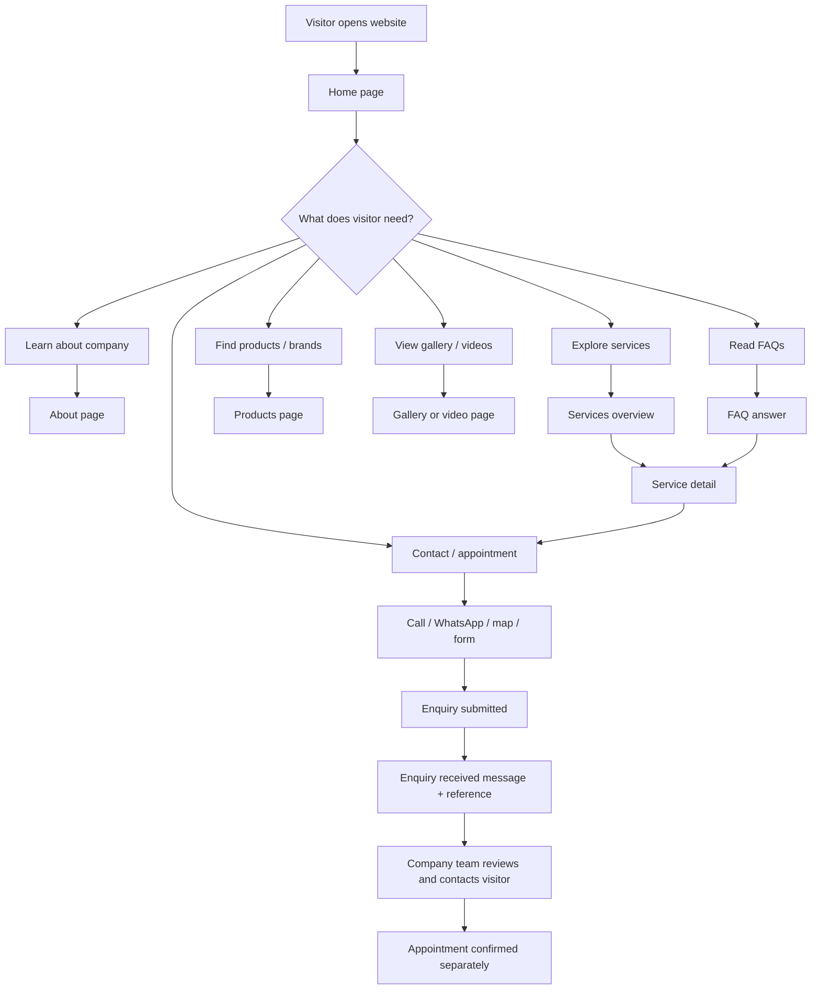
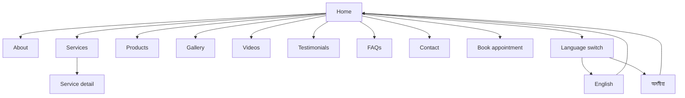
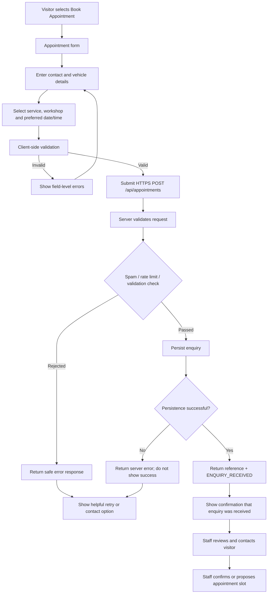
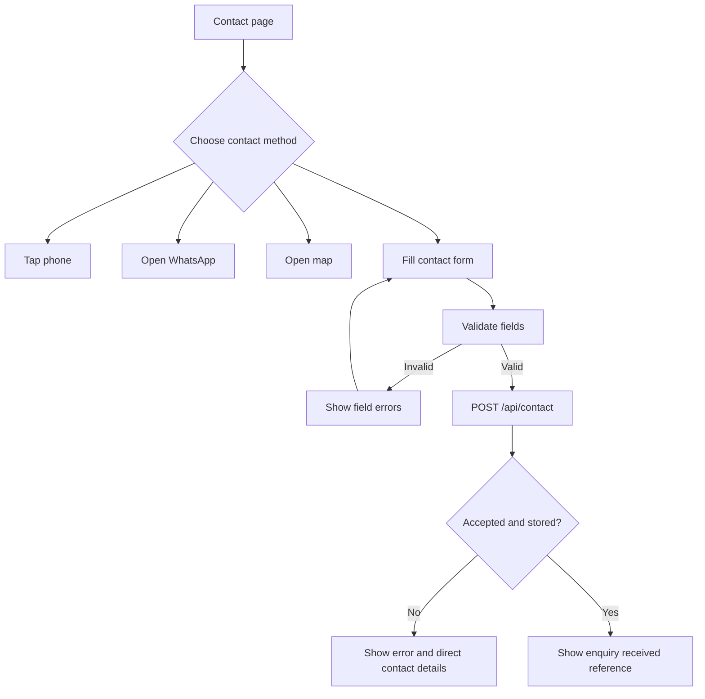
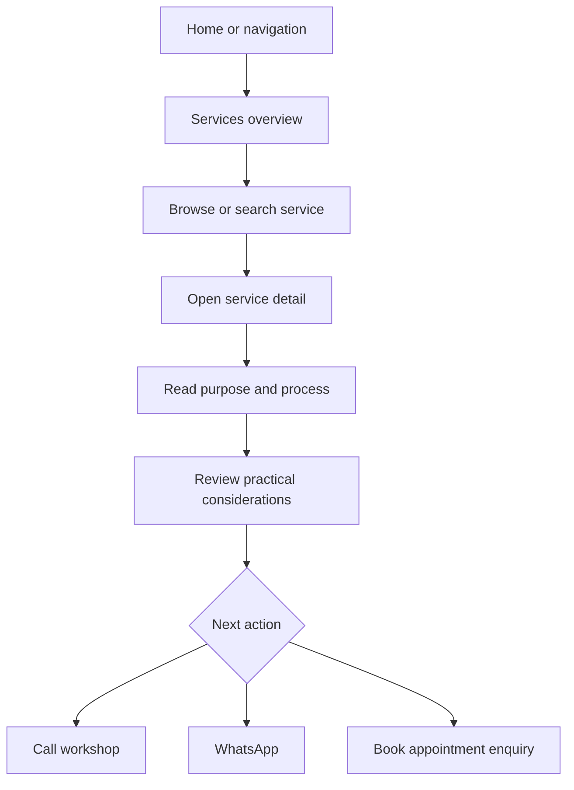

# Application Flow
## Car's Energy Co. Public Website

- **Version:** 1.0
- **Scope:** Public visitor journeys; no customer authentication

---

## 1. High-level site flow

## 2. Navigation flow

Language switching should keep the visitor on the equivalent current route wherever translated content exists.

## 3. Appointment enquiry flow

**Important:** The website must not display “Appointment confirmed” merely because the API accepted an enquiry.

## 4. General contact flow

## 5. Service discovery flow

## 6. Gallery and video flow

- Visitor opens Gallery or Videos.
- Visitor selects a category or item.
- Image opens in accessible lightbox, or video opens with user-controlled playback.
- Visitor can close with visible close control, Escape key and (for lightbox) arrow-key navigation where supported.
- No video should autoplay with sound.

## 7. Error and fallback flow

| Situation | Expected behaviour |
|---|---|
| Unknown route | Show custom 404 with Home and Services links |
| API unavailable | Explain that the enquiry could not be submitted; show phone/WhatsApp |
| Invalid form | Keep entered values and show field-level errors |
| Rate limit reached | Explain that the visitor should wait or call the workshop |
| Missing translation | Use a development warning; do not silently ship mixed-language UI |
| Image fails | Show a useful fallback and preserve layout dimensions |
| No video embed | Show a clear unavailable state rather than a broken player |

## 8. Authentication and roles

There is no customer login and no public customer account role.

Operational access to enquiry records is outside the public website scope. If a staff dashboard is added in a future release, it must be a separate, access-controlled project with staff authentication, authorisation, audit logging and a privacy review.

## 9. Advanced Feature Flows

### 9.1 Theme Toggle Flow
- Visitor clicks Sun/Moon icon in desktop navbar or mobile drawer.
- Theme state toggles immediately between Light and Dark mode.
- Preference saves to `localStorage` and persists across navigation and page reloads.

### 9.2 Site-Wide Search Flow
- Visitor clicks Search icon or presses `Ctrl+K` / `Cmd+K`.
- Search modal opens with focus trapped in input.
- Visitor types keyword (e.g. "ECU Tuning" or "হাইড্ৰ টেষ্টিং").
- Live results appear categorized by type with matched terms highlighted.
- Visitor navigates with Arrow keys and presses Enter or clicks result to jump directly to page.
- Pressing Escape closes modal.

### 9.3 Appointment Modal Review & WhatsApp Handoff Flow
- Visitor completes appointment form and clicks "Review & Continue".
- Confirmation modal opens displaying all entered customer, vehicle, and scheduling data.
- Clicking "Edit Details" dismisses modal with all input data intact.
- Clicking "Confirm & Continue":
  1. Submits appointment enquiry and UTM attribution to `/api/appointments`.
  2. Receives official Reference ID.
  3. Pre-fills structured message targeting verified WhatsApp number +91 79828 24255.
  4. Opens WhatsApp and updates webpage with handoff confirmation and fallback direct call hotline.

### 9.4 Floating Contact Widget Flow
- Fixed button anchored at bottom-right corner.
- Clicking reveals 3 direct actions: WhatsApp (+91 79828 24255), Call (+91 92122 18180), and Book Inspection.
- Collapses on selection, outside click, or Escape key.

### 9.5 Detailed Flow Documentation
- Advanced Feature Flow: `docs/ADVANCED_FEATURES.md`
- WhatsApp Handoff Lifecycle: `docs/WHATSAPP_INTEGRATION.md`
- Campaign Attribution Lifecycle: `docs/UTM_TRACKING.md`

