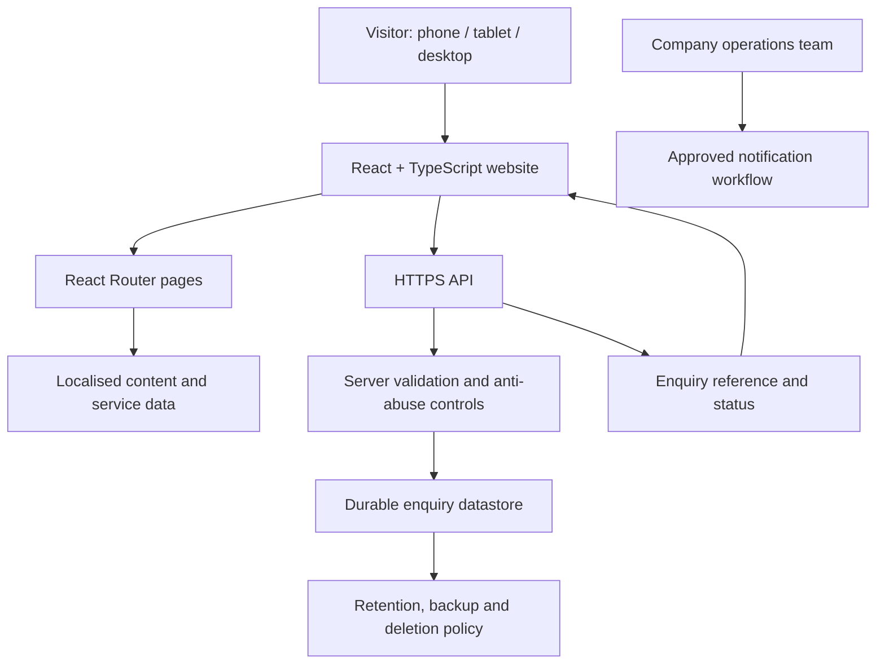

# Technical Requirements Document (TRD)
## Car's Energy Co. — Web Application

- **Status:** Engineering baseline; production decisions require approval
- **Version:** 1.0
- **Current implementation observed:** React 18, TypeScript, Vite 6, Tailwind CSS, React Router, Express 4

---

## 1. Purpose

This document describes the technical structure, runtime behaviour, interfaces, data handling, security controls and operational requirements for the Car's Energy Co. public website.

It distinguishes the current codebase from production requirements. The presence of middleware or a security document is not proof that the deployed system is secure.

## 2. Current stack observed in the archive

| Layer | Current technology |
|---|---|
| UI | React 18 + TypeScript |
| Build/dev | Vite 6 |
| Styling | Tailwind CSS + custom CSS |
| Routing | React Router DOM 6 |
| Icons | lucide-react |
| Page metadata | react-helmet-async |
| API | Node.js + Express 4 |
| HTTP hardening | Helmet |
| CORS | cors |
| Rate limiting | express-rate-limit |
| Persistence | Local JSON file at `server/data/enquiries.json` |
| Tests | Node native test runner |

Current package scripts include `dev`, `build`, `lint`, `preview`, `server`, `start` and `test`.

## 3. Target architecture



The public website must not expose an administrative interface or customer account system in this release. Enquiry access should be restricted to authorised company personnel through an independently secured operational process.

## 4. Frontend requirements

### 4.1 Application
- Use React and TypeScript with strict type checking.
- Use React Router for page navigation.
- Keep shared layout elements in reusable components.
- Keep page content and translation data separate from presentation.
- Provide a central source for company contact details and business facts.
- Keep route definitions and sitemap entries consistent.

### 4.2 Localisation
- Locale dictionaries live under `src/locales/en` and `src/locales/as`.
- Use a central language context/provider.
- Provide fallback behaviour for missing translations during development, but block release if customer-visible strings are missing.
- Test key Assamese glyphs and conjuncts on Android, Windows and iOS browsers.
- Use a font stack that reliably renders Assamese; do not assume a font-family declaration guarantees that the font is loaded.

### 4.3 Responsive UI
- Mobile-first breakpoints.
- No horizontal scrolling at 320 CSS pixels and above.
- Navigation, forms, cards, gallery and footer must adapt to narrow widths.
- Support touch, mouse and keyboard interaction.

### 4.4 Animation
- Prefer CSS transitions for simple interaction.
- Use JavaScript animation only when necessary.
- Avoid scroll handlers that trigger expensive React renders on every scroll event.
- Pause or simplify nonessential motion when reduced motion is enabled.
- Avoid autoplaying carousels where they impair reading; provide pause/controls if auto-rotation is retained.

## 5. Backend API requirements

### 5.1 Current API routes observed
- `GET /api/health`
- `POST /api/appointments`
- `POST /api/contact`

### 5.2 Appointment request
Expected fields in the current frontend/backend contract include:
- `fullName`
- `mobileNumber`
- `email` (optional)
- `vehicleMake`
- `vehicleModel`
- `vehicleYear`
- `serviceRequired`
- `preferredWorkshop`
- `preferredDate`
- `preferredTime`
- `additionalMessage`
- anti-spam fields (`honeypot`, `submittedAt`)

The API must:
1. Validate request shape and field lengths.
2. Validate mobile and optional email format.
3. Validate date/time and reject invalid or past dates where applicable.
4. Reject spam signals and enforce rate limits.
5. Store the enquiry reliably.
6. Return a generated reference and `ENQUIRY_RECEIVED` status.
7. Never claim the appointment is confirmed until staff confirms it.

### 5.3 General contact request
The contact API accepts a general enquiry and should use the same validation, abuse prevention, storage, privacy and error-handling standards.

### 5.4 API response convention
Success:
```json
{
  "success": true,
  "referenceNumber": "CE-YYYY-1234",
  "status": "ENQUIRY_RECEIVED",
  "message": "Your enquiry has been received. The team will contact you."
}
```

Validation failure:
```json
{
  "success": false,
  "error": "Please check the highlighted fields.",
  "details": []
}
```

Server failure must return a generic message and a correlation/reference ID where feasible. Do not return stack traces or filesystem paths.

## 6. Data and persistence

### Current state
The current Express implementation stores enquiries in a local JSON file and uses temporary-file rename logic. This is suitable only as a limited prototype or low-concurrency deployment with a persistent disk and careful backup. It is not a managed database and can be vulnerable to concurrent write conflicts, disk loss and ephemeral-host filesystem behaviour.

### Production requirement
Before launch, select a durable datastore supported by the hosting provider (for example, managed PostgreSQL or another managed relational database). Do not assume the local JSON file is a production database.

Minimum enquiry record:
- Internal unique ID.
- Public reference number.
- Enquiry type.
- Created timestamp.
- Status.
- Customer name.
- Contact number.
- Optional email.
- Vehicle/service details.
- Preferred workshop/date/time.
- Message.
- Privacy notice version/consent timestamp where consent is collected.

Data controls:
- Restrict access to authorised staff and service processes.
- Encrypt transport with HTTPS; use managed encryption at rest where available.
- Define retention and deletion periods.
- Back up and periodically test restoration.
- Never include enquiry records in source control or public build assets.
- Do not log full phone numbers, email addresses or message bodies.

## 7. Security requirements

### 7.1 Required controls
- HTTPS for all production traffic.
- Helmet security headers and a reviewed Content Security Policy.
- Strict, environment-configured CORS allowlist.
- Request body size limits.
- Server-side schema validation and field length limits.
- Output encoding and safe rendering.
- Rate limits per route and, where appropriate, per trusted client identity.
- Anti-spam controls that do not rely solely on hidden fields or client timestamps.
- Secure environment variable handling.
- Dependency and vulnerability review.
- Generic error responses.
- Privacy-conscious logs.
- Access-controlled backups and retention.

### 7.2 Current code review notes
- CORS origins are hard-coded in `server/index.js`; `.env.example` documents `CORS_ORIGINS`, but the current server code should be checked to ensure it actually reads that setting.
- The CSP currently includes `'unsafe-inline'` for scripts and styles; review whether nonces/hashes or a stricter policy can replace this.
- `sanitizeString` removes several characters globally. This can damage legitimate names/messages and is not a substitute for context-aware output encoding. Prefer schema validation, length limits and safe rendering.
- The JSON-file write path should be replaced with a durable datastore and concurrency-safe persistence for production.
- `server/data/enquiries.json` must not contain real customer data in a distributed source archive.
- Configure trusted proxy handling only for the actual hosting topology before relying on client IP rate limiting.
- Validate date formats and business hours server-side.
- Ensure the privacy notice accurately explains what is collected, why, who can access it and how long it is retained.

## 8. SEO and discoverability

- Server or prerender important public page content where needed for reliable indexing.
- Unique title and meta description per route.
- Canonical URLs use the official HTTPS domain.
- Keep sitemap and robots files aligned with actual routes.
- Use structured data only for facts that are accurate and visible on the page.
- Do not mark up fabricated reviews, ratings or unsupported credentials.
- Add meaningful alt text; decorative images use empty alt text.
- Validate structured data and search indexing after deployment.

## 9. Performance and accessibility

- Optimise images and serve appropriate responsive sizes.
- Lazy-load below-the-fold images and video embeds.
- Reserve image dimensions to reduce layout shift.
- Minimise JavaScript and third-party scripts.
- Use accessible labels, headings, landmarks and focus order.
- Provide visible focus indicators and clear validation errors.
- Meet WCAG 2.2 AA as the target.
- Respect `prefers-reduced-motion`.
- Measure Core Web Vitals on real production pages.

## 10. Environments and configuration

Recommended environments:
- Local development.
- Staging/preview.
- Production.

Use `.env.example` for variable names only. Store real values in the host's secret manager/environment configuration. Validate required configuration at server startup.

Suggested configuration:
- `NODE_ENV`
- `PORT`
- `CORS_ORIGINS`
- `DATABASE_URL`
- `RATE_LIMIT_WINDOW_MS`
- `RATE_LIMIT_MAX_REQUESTS`
- `FORM_SUBMIT_LIMIT_MS`
- `FORM_SUBMIT_MAX_REQUESTS`
- notification provider settings only if a notification service is approved.

## 11. Deployment topology

Recommended production topology:
- Static frontend assets served through a CDN or the Express application.
- Express API behind HTTPS reverse proxy/load balancer.
- Managed persistent database.
- Centralised secret management.
- Monitoring and backups.

If frontend and API are hosted separately, configure exact production origins and API base URL. Do not rely on the development Vite proxy in production.

## 12. Testing requirements

- TypeScript build.
- Automated route and locale checks.
- API success and validation tests.
- Spam/rate-limit tests.
- Persistence and backup/restore tests.
- Responsive browser tests.
- Keyboard and screen-reader checks.
- Reduced-motion checks.
- SEO and structured-data validation.
- Production smoke tests.
- Dependency audit.

## 13. Operational requirements

- Monitor API availability and server errors.
- Keep a deployment/rollback record.
- Back up the enquiry datastore.
- Restrict operational access to customer enquiries.
- Define an incident response contact and process.
- Re-test security headers and CORS after every hosting/domain change.
